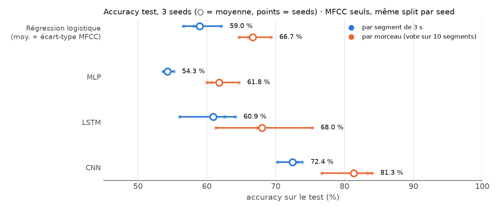
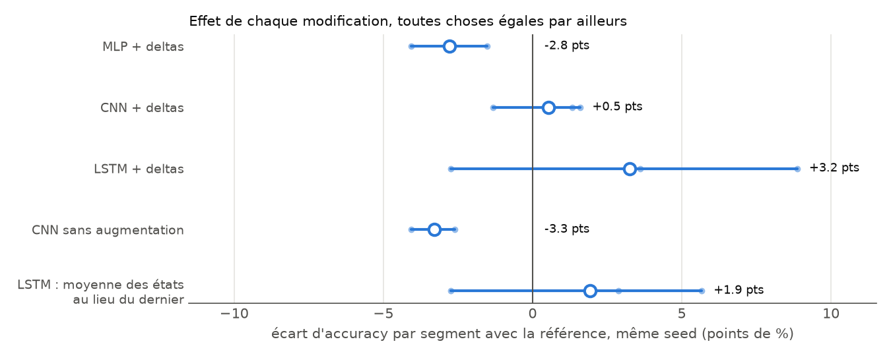
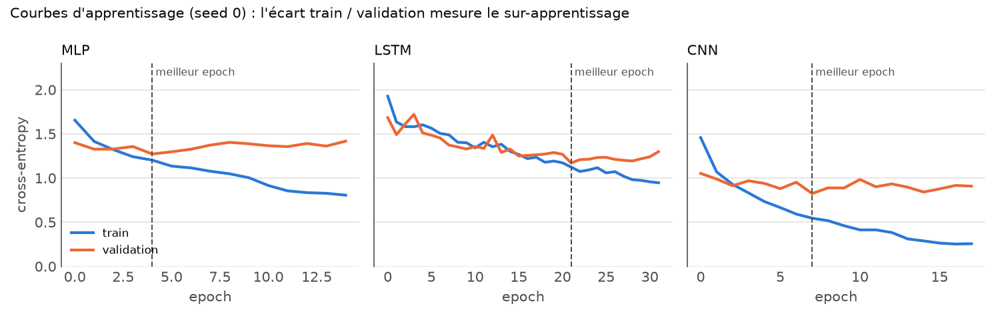
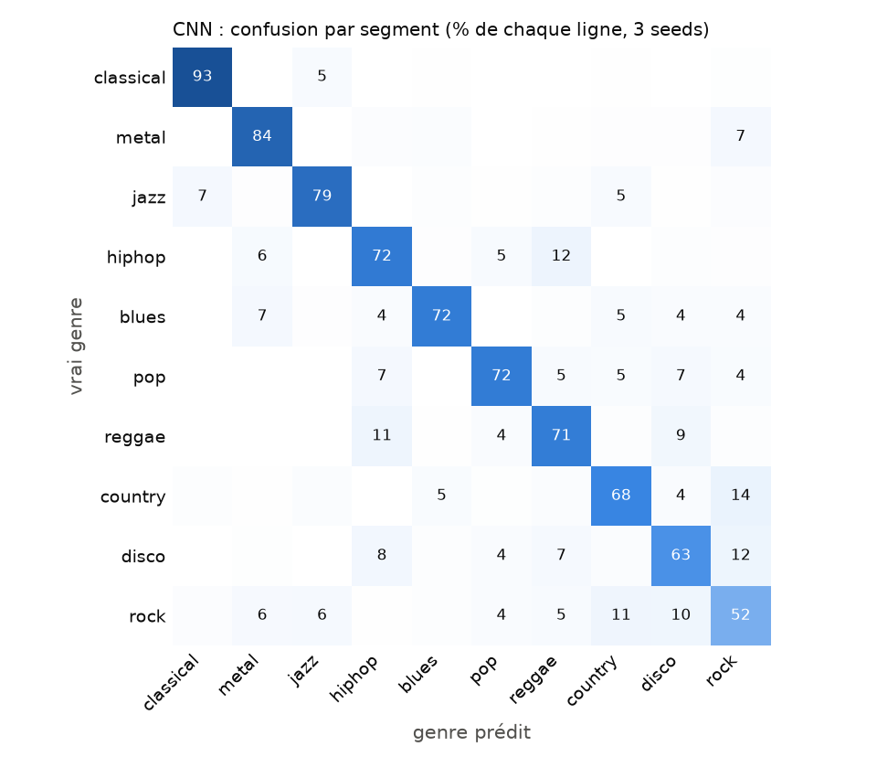

# Music Genre Classifier: which architecture makes the most of a 3-second clip?

Classifying the 10 genres of **GTZAN** from MFCCs. I compare a logistic regression, an MLP, an LSTM and a CNN **under an identical protocol**, then measure the effect of each improvement separately: deltas, augmentation, LSTM pooling, track-level voting. Stack: PyTorch, Lightning, Hydra, W&B.



## Summary

| Model | Parameters | Segment accuracy | Segment macro F1 | Track accuracy (vote) |
|---|---:|---:|---:|---:|
| Logistic regression (MFCC mean + std) | 270 | 59.0 ± 2.9 | 58.3 | 66.7 ± 2.4 |
| MLP | 450 K | 54.3 ± 0.8 | 52.6 | 61.8 ± 2.5 |
| LSTM | 58 K | 60.9 ± 4.3 | 60.7 | 68.0 ± 7.0 |
| **CNN** | **102 K** | **72.4 ± 1.9** | **72.3** | **81.3 ± 4.1** |

*Test set: 150 unseen tracks (15 per genre), i.e. 1,500 segments. Mean ± standard deviation over 3 seeds (each seed changes both the split and the initialization, and all models of a given seed share the same split). Input: 13 MFCCs × 130 frames. Raw results: [results/benchmark.json](results/benchmark.json).*

1. **Local time-frequency structure is what matters.** The CNN beats the LSTM by **+11.5 points**, on every one of the 3 seeds (from +9.1 to +14.2), with fewer parameters than the MLP.
2. **A deep network is not automatically better than a simple baseline.** The MLP (450 K parameters) does **worse** than a 270-parameter logistic regression (−4.7 points), and the LSTM only beats it by 2 points on average, with no clear margin.
3. **Voting over a track's 10 segments** gives the CNN **+9 points** (72.4 → 81.3) with no retraining. Part of the error on a 3 s clip is noise, which aggregation averages out.
4. **What doesn't always work**: deltas help the LSTM (+3.2 points), do nothing for the CNN (+0.5) and hurt the MLP (−2.8). Augmentation gives the CNN +3.3 points.

## The problem

- **Data**: [GTZAN](https://www.kaggle.com/datasets/andradaolteanu/gtzan-dataset-music-genre-classification). 10 genres × 100 tracks of 30 s (one file is corrupted, so 999 tracks). Each track is cut into **10 segments of 3 s**, giving 9,986 examples.
- **Representation**: 13 **MFCCs** per frame (2,048-sample window, hop of 512 at 22,050 Hz), i.e. a 130 × 13 matrix per segment. MFCCs summarize the spectral envelope on a perceptual (mel) scale: they describe **timbre** more than melody. Optionally, I add the first and second time derivatives (deltas), which gives 130 × 39. Code: [src/data/preprocessing.py](src/data/preprocessing.py).
- **Task**: predict the genre of a segment, then of a whole track by averaging the probabilities of its 10 segments.

## Hypotheses

Each architecture makes a different assumption about the structure of the signal:

| Model | What it assumes | What it sees |
|---|---|---|
| **Logistic regression** | Genre can be read from global timbre statistics | Mean and standard deviation of each MFCC over the segment (26 numbers): temporal order is lost |
| **MLP** | No structure: each (frame, coefficient) cell is an independent input | The flattened matrix (1,690 values): the same pattern shifted by one frame becomes a completely different input |
| **LSTM** | Genre lies in the **temporal evolution** of timbre | The sequence of 130 frames, read in order (2 layers of 64) |
| **CNN** | Genre lies in **local** time-frequency **patterns** (attacks, rhythms, textures), wherever they appear | The matrix as an image: 3 convolutions 3×3 (32, 64, 128 channels), BatchNorm, max-pooling, then global average pooling |

I expected CNN > LSTM > MLP, with the MLP staying above the linear baseline. The second part turned out to be **wrong**.

## Protocol

Everything except the variable under study is identical across runs ([src/benchmark.py](src/benchmark.py)):

- **Track-level split, stratified by genre**: 70 / 15 / 15 % of the tracks. A track's 10 segments always land in the same set (see [the leak](#the-segment-split-trap) below).
- **Per-coefficient normalization**, with statistics computed on the training set only.
- **Training**: AdamW (lr 1e-3, weight decay 1e-4), batch size 32, `ReduceLROnPlateau`, early stopping on validation loss (patience 10, at most 100 epochs). **Testing uses the best-validation checkpoint**, not the last one.
- **Augmentation** for every network, with probability 0.5: Gaussian noise, a time mask (up to 8 frames) and a frequency mask (up to 3 coefficients), in the spirit of SpecAugment.
- **3 seeds** (0, 1, 2). Every comparison is **paired**: two variants are compared on the same split.
- Same hyperparameters for all architectures: **no per-model tuning** (see [Limitations](#limitations)).

## Results

### Effect of each change



| Variant (vs. its reference, same seed) | Δ segment accuracy | Δ per seed | Δ track accuracy |
|---|---:|---|---:|
| MLP + deltas | −2.8 | −1.5 / −2.7 / −4.1 | −0.4 |
| CNN + deltas | +0.5 | +1.6 / −1.3 / +1.3 | −0.4 |
| LSTM + deltas | +3.2 | +8.9 / +3.6 / −2.7 | +4.2 |
| CNN without augmentation | −3.3 | −3.2 / −2.6 / −4.1 | −1.8 |
| LSTM, mean of hidden states instead of the last one | +1.9 | +5.7 / +2.9 / −2.7 | +2.0 |
| CNN, segment-level split (**leak**, not in the figure) | **+19.3** | +22.3 / +18.1 / +17.7 | +13.1 |

Only two effects have **the same sign on all 3 seeds**: augmentation (helps the CNN) and deltas for the MLP (hurt). The others stay within seed-to-seed noise.

### Learning curves



- **MLP**: validation loss is lowest as early as epoch 2 to 5, then rises while training loss keeps falling. This is immediate overfitting: 450 K parameters for about 7,000 training segments, and no shift invariance. With deltas the input triples (1.3 M parameters) and the problem gets worse, which explains the −2.8.
- **LSTM**: learns slowly (best validation between epochs 21 and 28) and stays underfit: training and validation remain close. It doesn't overfit, it plateaus. Averaging the hidden states instead of keeping the last one helps slightly, which suggests the last state forgets part of the segment.
- **CNN**: learns fast and generalizes best, but the train / validation gap widens (6 to 15 accuracy points at the best epoch). Without augmentation, the best epoch comes earlier (5 or 6 vs. 7 to 16) and accuracy drops by 3 points.

### Where the CNN gets it wrong



F1 per genre (3 seeds pooled): classical 91, metal 81, jazz 81, blues 77, pop 75, hiphop 70, reggae 69, country 68, disco 62, **rock 52**.

The confusions make musical sense. **Rock** is confused with country, disco and metal. **Disco** is confused with rock and hiphop. **Hiphop** is confused with reggae (12 %). These genres share instrumentation and production: MFCCs capture timbre, not the harmonic or cultural structure that tells them apart. Conversely, classical and metal have very distinctive timbres and are almost always recognized.

### The segment-split trap

If **segments** are assigned at random (instead of tracks), clips from the same track end up in both train and test. The CNN then reaches **91.8 ± 0.8 %** instead of 72.4 % (+19.3 points, and 94.4 % at track level). This is not a better model: it **recognizes tracks it has already heard** instead of generalizing to a new one. All other experiments use the track-level split.

## Limitations

- **GTZAN has known faults** ([Sturm, 2013](https://arxiv.org/abs/1306.1461)): duplicates, mislabeled excerpts and, above all, **several tracks by the same artist**. My split is by track, not by artist: part of the performance probably comes from recognizing an artist or an album, so the numbers are likely optimistic.
- **Small test set**: 150 tracks. One track is worth 0.67 accuracy points at track level, and the 95 % binomial confidence interval around 81 % is about ±6 points. Differences of less than 3 or 4 points between variants are not conclusive with 3 seeds.
- **No per-architecture tuning.** The hyperparameters (lr, dropout, size) were originally tuned for the CNN. The LSTM in particular is probably penalized (lr, depth and bidirectionality not explored). The comparison is between architectures "at an equal tuning budget", not at their best potential.
- **13 MFCCs is a very compressed representation.** Modern audio CNNs tend to work on mel-spectrograms (128 bands) or use models pretrained on large corpora. I didn't test those: this project is about comparing architectures on a fixed input.
- **3 seeds**: enough to see the large gaps (CNN vs. the rest, MLP vs. the baseline), not to settle 1- or 2-point effects.

## Next steps

- An **artist-level** split to measure the effect of artist leakage.
- Mel-spectrograms instead of MFCCs, and a slightly deeper CNN.
- CRNN (convolutions then LSTM): combining local patterns and temporal dynamics.
- Per-architecture hyperparameter search (Hydra multirun or a W&B sweep), then 5 seeds instead of 3.

## Project history

1. **[AudioDeepLearning](../AudioDeepLearning/)** (first version, plain PyTorch): MLP, then CNN, then LSTM. The MLP overfit. The CNN reached 71.4 % (with augmentation and oversampling of the confused genres), the LSTM 48.4 %. These numbers **are not comparable** with each other: the settings were different, and the test set wasn't stratified (5 classical tracks vs. 23 country tracks).
2. **Rewrite** with Lightning + Hydra + W&B: versioned configs and tracked runs. First observation on 1 seed: deltas do nothing for the CNN (75.6 % vs. 75.1 %).
3. **Controlled benchmark** (this README): stratified split, 3 seeds, all architectures in the same pipeline, one ablation per factor, and a non-deep baseline.

## Structure

```
src/
├── data/
│   ├── preprocessing.py   # audio -> 3 s segments -> MFCC (+ deltas) -> dataset/mfcc.npz
│   ├── data.py            # GTZANDataModule: stratified track-level split, normalization, DataLoaders
│   └── augmentation.py    # noise + time / frequency masks
├── models/                # MLP, CNN, LSTM + build_backbone(cfg.model)
├── module.py              # LightningModule: loss, metrics (acc, F1, AUROC), optimizer
├── train.py               # trains one Hydra config (logged to W&B)
├── benchmark.py           # every experiment × 3 seeds -> results/benchmark.json
├── figures.py             # the figures of this README
└── configs/               # Hydra: data/, model/ (cnn, mlp, lstm), training/, experiment/
```

## Reproduce

```bash
uv sync
# download GTZAN into dataset/genres_original/, then:
uv run python -m src.data.preprocessing              # -> dataset/mfcc.npz
uv run python -m src.train model=lstm data.use_deltas=true   # a single run, logged to W&B
uv run python -m src.benchmark                       # the full benchmark (about 1 h on a GTX 1650)
uv run python -m src.figures
```
