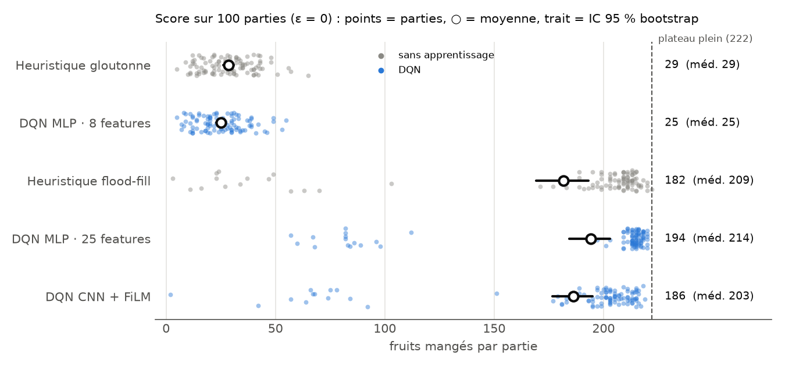
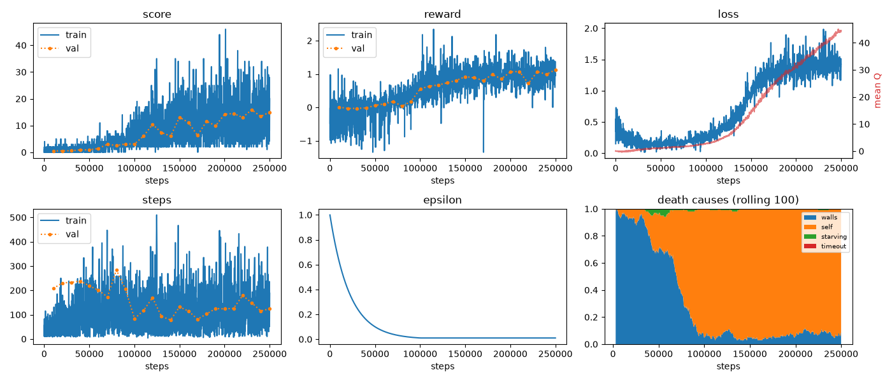
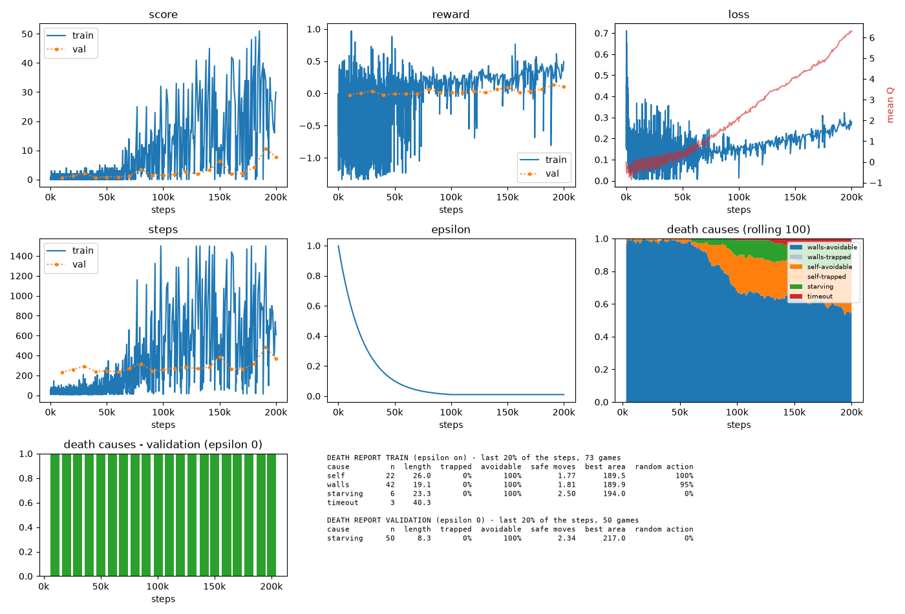
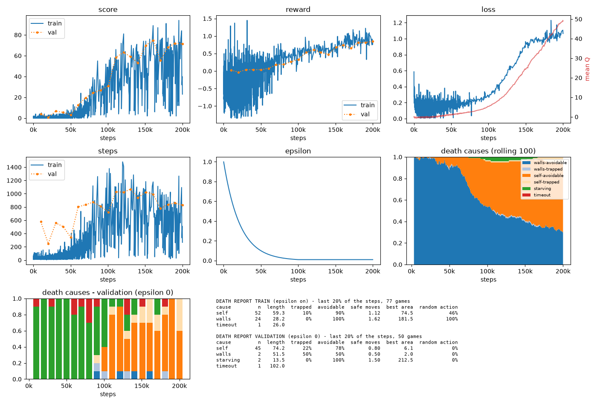
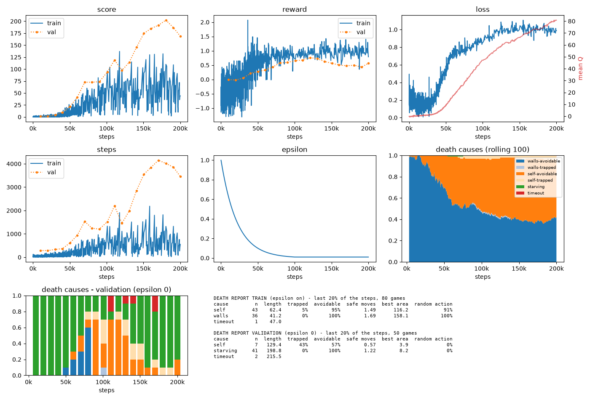
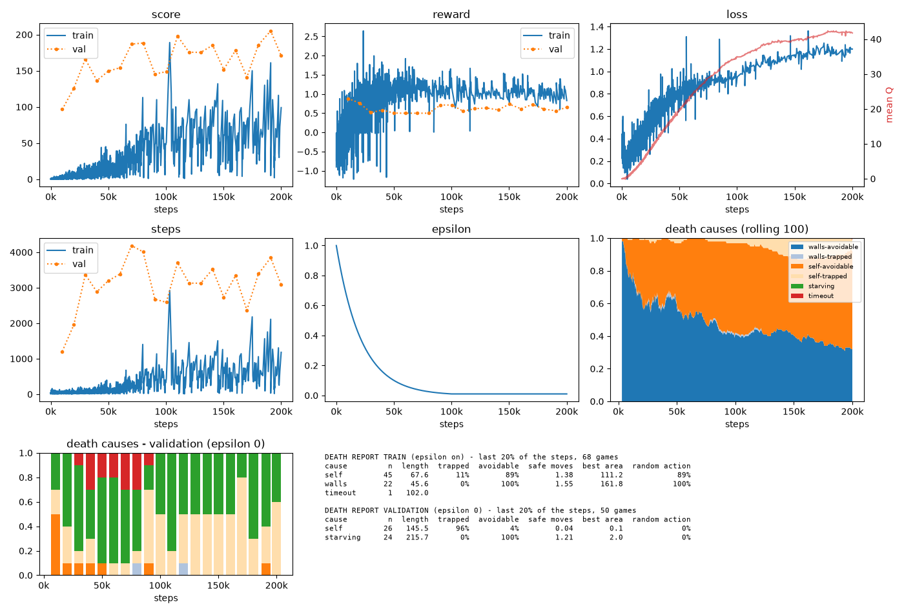
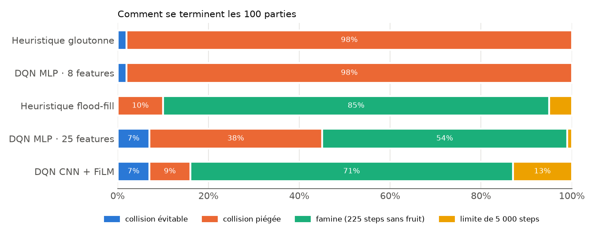

# snakeRL: what actually makes a DQN agent better at Snake?

A **Double DQN** agent, written from scratch in PyTorch, learns to play Snake on a 15×15 grid. The goal is not just a good score. I want to find out **where the performance comes from**: the architecture (MLP or CNN), the information given as input, or the learning itself.



## Summary

| Agent | Input | Parameters | Mean score [95 % CI] | Median | Max |
|---|---|---:|---:|---:|---:|
| Greedy heuristic (no learning) | 8 features | – | 28.5 [26.3, 30.9] | 29 | 65 |
| DQN MLP | 8 features | 69 K | 25.1 [23.1, 27.3] | 25 | 55 |
| Flood-fill heuristic (no learning) | same 17 features as the networks | – | 181.7 [169.2, 193.0] | 209 | **222** |
| DQN CNN + FiLM | 4×17×17 grid + 17 features | 4.76 M | 186.3 [176.7, 194.9] | 203 | 219 |
| **DQN MLP** | **25 features** | **73 K** | **194.3 [184.2, 203.0]** | **214** | 220 |

*100 games per agent, ε = 0, same seeds, 5,000-step limit per game. Maximum possible score: 222 fruits (225-cell board full, the snake starts at length 3). Bootstrap 95 % CI. Script: [src/evaluate.py](src/evaluate.py).*

Three conclusions:

1. **Input information matters far more than architecture.** With 8 local features, the DQN plateaus at 25 fruits. With the 17 flood-fill features, the score goes up roughly 7×.
2. **A hand-written rule using the same features does almost as well.** The flood-fill heuristic averages 182. The CNN is not significantly better (186, Mann-Whitney p = 0.14). The MLP is, but modestly (194, p ≈ 10⁻⁷).
3. **The small MLP beats the large CNN** (194 vs. 186, p ≈ 10⁻⁹) with 65× fewer parameters. Once the features are computed, the raw grid adds nothing. (Important caveat: a single training run per configuration, see [Limitations](#limitations).)

## The problem

- **Environment**: 15×15 grid, 3 fruits on the board at all times, the snake starts at length 3. A U-turn is turned into "keep going straight".
- **Rewards**: +10 per fruit, −10 on death, −0.01 per step, and +0.1 × (distance to fruit before − after). The last term is an approach bonus that cancels out when the snake goes in circles.
- **Game over**: collision with a wall or with itself, or **starvation** (225 steps without eating, −10). Without the starvation rule, a cautious agent learns to circle forever.

## Hypotheses and approach

I worked iteratively: each failure pointed to the next hypothesis. The scores below are read off the saved validation curves (mean of 10 games at ε = 0, hence noisy). They are orders of magnitude, not controlled measurements.

| # | Hypothesis tested | Run(s) | Validation at end of training | Takeaway |
|---|---|---|---:|---|
| 1 | An MLP on 8 features (immediate danger in 4 directions, fruit direction) is enough | `mlp`, `mlp-target` | ≈ 20–30 | Learns fast but plateaus: it only sees one cell around the head and ends up trapping itself. |
| 2 | A CNN that sees the whole grid will learn to avoid traps | `cnn` (8-channel grid) | ≈ 5–15 | Much slower to learn, and no better at an equal budget. |
| 3 | n-step returns (n = 3) speed up reward propagation | `cnn-n3` / `cnn-n1` (250 K steps) | ≈ 5 / ≈ 11–15 | Worse with n = 3. I keep n = 1. |
| 4 | The CNN doesn't "see" enclosed areas: it needs the size of the reachable area after each action (flood-fill) | `cnn-n1-flood` → `cnn-n1-c12-flood` | ≈ 15 → **≈ 73** | The biggest jump of the whole project. |
| 5 | The ceiling comes from the training budget or the network's capacity | `cnn-500k`, `cnnbig-200k` (3 conv + dueling) | ≈ 75–80 | No: 2.5× more steps or a bigger network barely change anything. |
| 6 | The −0.01 per-step penalty is necessary | `cnn-200k-no-reward` | ≈ 8 | Without it, the agent learns to survive without eating and starves in 100 % of validation games. |
| 7 | The 17 scalars are poorly used when injected as constant planes into the convolutions | `exp-base` → `exp-film` → `exp-film2` → `exp-film3` | ≈ 70 → ≈ 80 → ≈ 110 → **≈ 170–200** | FiLM (channel modulation by the scalars) and a per-action advantage term unlock the rest. `exp-film2` was capped by a 1,500-step limit per game. |
| 8 | **Control**: does an MLP that only gets the scalars, with no grid, do as well? | `exp-mlp-scalars` | ≈ 150–200, and ≈ 100 after only 10 K steps | Yes. Hence the controlled evaluation above, plus a heuristic with no learning. |

The 17 scalars (computed in [`Game.action_scalars`](src/snake/game.py)): current direction (4), size of the reachable area after each action (4), whether that area is big enough for the body (4), whether the tail is still reachable after each action (4), and hunger (steps since the last fruit / 225).

<details>
<summary>Training curves of the key runs</summary>

Each dashboard shows: score, reward, loss and mean Q, game length, ε, and causes of death (training and validation).

**Before flood-fill** (`cnn-n1-flood`, ≈ 15)


**Without the per-step penalty** (`cnn-200k-no-reward`): validation games only end by starvation


**Scalars as constant planes** (`exp-base`, ≈ 70)


**CNN + FiLM** (`exp-film3`, the evaluated model)


**MLP on the 25 features** (`exp-mlp-scalars`, the evaluated model): above 100 from the first validation


</details>

## Controlled evaluation

Since validation during training only covers 10 games, I re-evaluated the final models on **100 games at ε = 0**, with the same seeds for all of them ([src/evaluate.py](src/evaluate.py)). I added **two baselines with no learning**, which read the game state directly:

- **Greedy heuristic**: among the moves that don't kill immediately, picks the one that gets closest to the fruit. It uses the same information as the 8 features.
- **Flood-fill heuristic**: prefers a move after which the tail stays reachable, then the largest reachable area, then the closest fruit. It uses the same information as the 17 scalars.

These baselines are the real point of comparison: they measure what learning adds **beyond** the information given to the network.



A "trapped collision" (*collision piégée* in the figure) is a death where none of the 3 possible moves was safe at the fatal moment: the mistake was made earlier. An "avoidable collision" (*collision évitable*) is a death even though a safe move existed.

### Discussion

- **8 features → the agent traps itself.** The DQN MLP-8 and the greedy heuristic both die trapped in 98 % of games. With a one-cell horizon, avoiding your own loops is impossible. The DQN even does slightly worse than the greedy rule (25 vs. 29, p = 0.04): it learned roughly that rule, nothing more. Caveat: this model only got 100 K training steps vs. 200 K for the others, but its curve had already plateaued.
- **Flood-fill → the problem changes nature.** Collision deaths become rare. Games mostly end by **starvation** on a board that is about 90 % full (54 to 85 % of games): the snake stays safe but can no longer reach the fruit within 225 steps. A perfect agent (Hamiltonian cycle) never starves, so there is still room to improve, and it requires **long-term planning** that none of these agents does.
- **What the DQN adds.** The MLP-25 mostly improves the top of the distribution (median 214 vs. 209 for the heuristic) and only starves in 54 % of games vs. 85 %. It therefore takes more risks to go get the fruit, and pays for it in collisions (45 % vs. 10 %). It's a learned risk / hunger trade-off, not a new understanding of the game.
- **CNN vs. MLP.** The CNN sees the whole grid but does no better than the heuristic. It has 4.76 M parameters, 4.7 M of which sit in the single dense layer after the convolutions, and it learns more slowly. Once board connectivity is summarized by flood-fill, raw vision adds little on a 15×15 grid.

## Limitations

- **A single training seed per configuration.** In RL, seed-to-seed variance is high. The MLP vs. CNN gap is significant *between these two models*, not necessarily *between these two architectures*. At least 3 to 5 seeds each would be needed.
- **The chronology is not a clean sequence of ablations.** Several factors sometimes changed between two runs, configurations weren't versioned (only the run name), and the per-game step limit varied (800, 1,500, then 5,000), which capped some scores. Only the [controlled evaluation](#controlled-evaluation) is reliable. This is the main methodological lesson of the project, applied afterwards in [MusicGenreClassifier](../MusicGenreClassifier/) (Hydra configs, multiple seeds).
- **The features do a large part of the work.** Flood-fill already encodes a good part of the policy. The results say as much about this feature engineering as about RL.
- **Design choices that shape the outcome**: the 225-step starvation rule, reward shaping, 3 simultaneous fruits. They weren't varied systematically.
- **A single grid size (15×15)**, and no generalization test.

## Next steps

- Several seeds per configuration, and a CNN without flood-fill but with a receptive field covering the whole grid. This would tell whether the network can *learn* connectivity instead of being given it.
- A Hamiltonian-cycle baseline as an upper bound.
- An egocentric view (grid centered on the head) and a prioritized replay buffer.

## How it works

| Block | File | Role |
|---|---|---|
| Game | [src/snake/game.py](src/snake/game.py) | Rules, rewards, state construction (grid, scalars, flood-fill) |
| DQN agent | [src/module.py](src/module.py) | ε-greedy, replay buffer, n-step returns, Double DQN target, update |
| Loop | [src/train.py](src/train.py) | Plays, validates every 10 K steps, classifies deaths, plots curves |
| Networks | [src/models/](src/models/) | `MLP`, `MLPScalars`, `CNN` (FiLM + dueling), `CNNBase`, `CNNBig` |
| Evaluation | [src/evaluate.py](src/evaluate.py), [src/figures.py](src/figures.py) | 100-game evaluation, baselines, the figures of this README |

**Algorithm.** Double DQN: the online network picks the next action and the target network evaluates it, which limits Q-value overestimation. Huber loss, gradient-norm clipping at 1.0, Adam optimizer. Uniform replay buffer (100 K transitions). The target network is copied every 200 updates, i.e. every 800 steps.

**CNN + FiLM.** The input is split into 4 planes of 17×17 (head, body weighted by age, fruits, border walls) and 17 scalars.
- The scalars **modulate** each convolution layer (FiLM: `h · (1 + γ) + β`, initialized to the identity) instead of being drowned among 18,496 features.
- The 3 per-action features (area, room for the body, tail reachable) go through a small shared MLP, added directly to that action's advantage. The head is dueling (V + A − mean(A)).

**Hyperparameters** ([src/main.py](src/main.py)): lr 1e-4, γ 0.99, ε from 1 to 0.01 over 100 K steps (exponential decay), batch 64, 1 update every 4 steps, 200 K steps in total.

## Reproduce

```bash
uv sync
uv run python -m src.main -m CNN -o exp-film3            # trains (200 K steps) -> checkpoints/, charts/
uv run python -m src.main -m MLPScalars -o exp-mlp-scalars
uv run python -m src.evaluate                            # 100 games per agent -> results/eval.json
uv run python -m src.figures                             # figures/ of this README
uv run python -m src.main -t play -m CNN -o exp-film3    # watch the agent play in the terminal
```

`checkpoints/` is not versioned: `src.evaluate` assumes the models were trained locally. The raw evaluation results are in [results/eval.json](results/eval.json).
